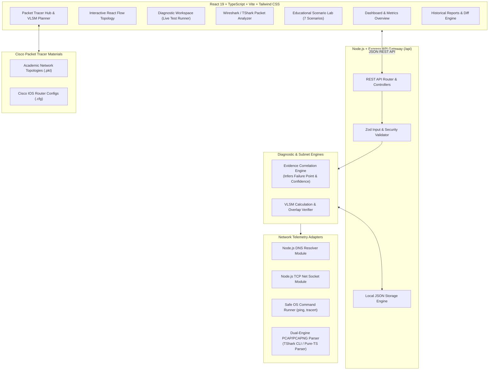

# CONNECTED DOESN'T MEAN CONNECTED
### An Interactive Network Connectivity and Failure Diagnosis Simulator

[](https://www.typescriptlang.org/)
[](https://nodejs.org/)
[](https://react.dev/)
[](https://tailwindcss.com/)
[]()
[]()

---

## 1. Project Abstract
In modern operating systems, a network status indicator displaying **"Connected"** merely confirms Layer 1 (Physical) link detection and Layer 2 (Data Link) frame association with a local switch or wireless access point. It provides zero guarantee that Layer 3 (IP routing), Layer 4 (Transport sockets), or Layer 7 (DNS resolution and application daemons) can deliver data.

**CONNECTED DOESN'T MEAN CONNECTED** is an evidence-based network diagnosis simulator, packet analysis engine, and interactive academic laboratory. Designed for undergraduate and graduate Computer Networks courses, it combines real operating system network telemetry (DNS resolution, TCP sockets, ping, traceroute), deep-packet inspection of standard PCAP/PCAPNG capture files (via TShark or a built-in native pure-TypeScript parser), and structured Cisco Packet Tracer lab topologies to isolate the root cause of network failures.

---

## 2. Problem Statement & Educational Objectives

### Problem Statement
Users frequently encounter situations where their computer reports active Wi-Fi or Ethernet connectivity, yet web browsers report *"Server Not Found"*, *"Connection Timed Out"*, or *"Gateway Unreachable"*. Most end-users and junior engineers lack the diagnostic methodology to identify which of the 5+ intermediate stages has failed.

### Core Objectives
1. **Differentiate OSI Layers:** Prove through concrete evidence why a functional Layer 2 link does not equal Layer 3 or Layer 7 availability.
2. **Empirical Diagnostic Engine:** Replace generic guess-work with a transparent, rule-based inference pipeline that tags evidence sources honestly (`LIVE_TEST`, `CAPTURE_ANALYSIS`, `LAB_EVIDENCE`, `SIMULATED`).
3. **Deep Packet Analysis:** Parse binary PCAP and PCAPNG capture traces to detect DNS NXDOMAIN errors, TCP RST connection refusals, and ICMP Destination Unreachable codes.
4. **Academic Lab Integration:** Provide complete Cisco Packet Tracer topologies, Cisco IOS configurations, and mathematically verified Variable Length Subnet Masking (VLSM) plans.

---

## 3. System Architecture & Component Interactions



---

## 4. Academic Evidence Tagging Matrix

To maintain strict academic honesty, every test observation is explicitly tagged:

| Evidence Tag | Description | Realism & Origin |
| :--- | :--- | :--- |
| **`LIVE_TEST`** | Real packets transmitted across host network interface | Measured live; real ICMP, DNS latency, and TCP sockets. |
| **`CAPTURE_ANALYSIS`** | Decoded from uploaded `.pcap` or `.pcapng` capture file | Parsed frame-by-frame by TShark or Native PCAP parser. |
| **`LAB_EVIDENCE`** | Documented Cisco Packet Tracer virtual simulation test | Sourced from virtual Cisco IOS CLI testing. |
| **`SIMULATED`** | Educational scenario baseline | Pre-packaged for classroom demonstrations. |

---

## 5. Educational Failure Scenarios

The system includes seven distinct scenarios demonstrating failure modes across the protocol stack:


1. **Baseline Normal Connectivity:** Complete end-to-end communication from Client through Router R1, R2, DNS, and Target Web Server. (All PASS)
2. **Local Access & DHCP Failure (APIPA):** Device associates with Layer 2 Wi-Fi/Switch, but receives no DHCP Offer, resulting in a self-assigned `169.254.x.x` address with no default gateway.
3. **Default Gateway Router Failure:** Client has a valid IP, but the default gateway router interface is shut down. Ping times out with *"Destination host unreachable"* due to ARP resolution failure.
4. **Routing Blackhole (Missing Route):** Default gateway responds to pings, but intermediate router R1 has no route to the remote server network. Router R1 returns **ICMP Type 3 Code 0** (*Destination Network Unreachable*).
5. **DNS Name Resolution Failure:** IP routing and physical links are 100% operational, but DNS server is offline or record is missing, returning **NXDOMAIN (RCODE 3)**.
6. **Target Service Daemon Closed (Port Down):** Target host responds to ICMP pings (creating the false illusion of health), but the web server daemon on TCP port 80 is stopped, returning an immediate **TCP RST** (*Connection Refused*).
7. **Network Congestion & High Packet Loss:** Saturated WAN transit link causes 35% queue drops and high latency jitter (150ms+), triggering repeated TCP SYN retransmissions.

---

## 6. VLSM Addressing Plan & Mathematical Verification

Designed using private IPv4 major network **`192.168.10.0/24`** with non-overlapping classless allocation:

| Subnet Name | Host Req. | Total IPs | Power of 2 | Prefix | Subnet Mask | Usable Range | Broadcast | Gateway Assigned |
| :--- | :--- | :--- | :--- | :--- | :--- | :--- | :--- | :--- |
| **LAN A (Student PCs)** | 50 | 52 | 64 ($2^6$) | `/26` | `255.255.255.192` | `192.168.10.1` - `.62` | `192.168.10.63` | R1 `Gi0/0/0` (`.1`) |
| **LAN B (Faculty)** | 25 | 27 | 32 ($2^5$) | `/27` | `255.255.255.224` | `192.168.10.65` - `.94` | `192.168.10.95` | R1 `Gi0/0/1` (`.65`) |
| **Server Farm** | 10 | 12 | 16 ($2^4$) | `/28` | `255.255.255.240` | `192.168.10.97` - `.110` | `192.168.10.111`| R2 `Gi0/0/0` (`.97`) |
| **WAN P2P (R1-R2)** | 2 | 4 | 4 ($2^2$) | `/30` | `255.255.255.252` | `192.168.10.113` - `.114`| `192.168.10.115`| R1/R2 `Se0/1/0` |

### Overlap Proof
$$[0, 63] \cap [64, 95] = \emptyset \quad;\quad [64, 95] \cap [96, 111] = \emptyset \quad;\quad [96, 111] \cap [112, 115] = \emptyset$$
$$\implies \textbf{Subnets do not overlap. All boundaries verified by automated test suite.}$$

---

## 7. Technology Stack

- **Frontend:**
  - React 19 + TypeScript
  - Vite 8.3
  - Tailwind CSS v4
  - Lucide React Icons
  - Recharts (Protocol distribution analytics)
- **Backend:**
  - Node.js 20+ / 24+
  - Express.js + REST API
  - Zod 3.24 (Strict request schema validation against shell injection)
  - Multer (PCAP file upload handler with automatic cleanup)
- **Packet Capture & Analysis:**
  - Dual-Engine: Wireshark / TShark CLI detector & invoker
  - Native pure-TypeScript PCAP / PCAPNG binary parser (zero native dependencies)
- **Testing & Quality Assurance:**
  - Vitest 3.0
  - Supertest 7.0

---

## 8. Installation & Quick Start

### Prerequisites
- Node.js (v18.0.0 or higher)
- npm (v9.0.0 or higher)

### Setup Commands
From the project root directory:

```bash
# 1. Install all dependencies across root, backend, and frontend
npm install
npm install --prefix backend
npm install --prefix frontend

# 2. Programmatically generate the 7 educational synthetic PCAP files
npm run generate-pcaps

# 3. Launch both Backend and Frontend concurrently
npm run dev
```

### Access URLs
- **Web Dashboard:** [http://localhost:5173](http://localhost:5173)
- **Backend API & Health:** [http://localhost:5001/api/health](http://localhost:5001/api/health)
- **Tools Status:** [http://localhost:5001/api/tools/status](http://localhost:5001/api/tools/status)

---

## 9. Automated Testing

Run the automated test suite covering subnet calculations, diagnostic rule attribution, binary packet parsing, and API security:

```bash
npm test
```

### Verified Test Matrix
```
✓ tests/subnet.test.ts (7 tests)
  ✓ converts IP to integer and back symmetrically
  ✓ calculates subnet mask from CIDR prefix
  ✓ calculates CIDR from subnet mask
  ✓ correctly computes subnet boundaries for a /26 network
  ✓ detects IP inclusion in subnet
  ✓ detects overlapping and non-overlapping subnets
  ✓ computes a valid non-overlapping VLSM plan

✓ tests/diagnosis.test.ts (7 tests)
  ✓ diagnoses physical/interface failure when NIC is down
  ✓ diagnoses default gateway failure when interface is up but gateway fails
  ✓ diagnoses DNS resolution failure when gateway passes but DNS fails
  ✓ diagnoses target service port down when L3 routing passes but TCP handshake fails
  ✓ identifies network congestion and packet loss
  ✓ returns healthy status when all tests pass
  ✓ returns INCONCLUSIVE when observations are empty

✓ tests/pcapParser.test.ts (6 tests)
  ✓ rejects truncated capture files (< 24 bytes)
  ✓ rejects capture files with invalid magic headers
  ✓ parses scenario-1-normal.pcap with DNS, TCP, and HTTP frames
  ✓ parses scenario-4-routing-failure.pcap with ICMP Destination Unreachable
  ✓ parses scenario-5-dns-failure.pcap with NXDOMAIN response
  ✓ parses scenario-6-service-closed.pcap with TCP RST flag

✓ tests/api.test.ts (7 tests)
  ✓ GET /api/health returns UP status and system metadata
  ✓ GET /api/tools/status reports TShark and system tools status
  ✓ GET /api/scenarios returns all 7 educational scenarios
  ✓ GET /api/network/interfaces returns local network information
  ✓ POST /api/diagnostics/run rejects shell injection attempts
  ✓ POST /api/diagnostics/run rejects invalid TCP port
  ✓ POST /api/lab/vlsm calculates and validates non-overlapping subnets

Test Files  4 passed (4)
     Tests  27 passed (27)
```

---

## 10. Honest Cisco Packet Tracer & Wireshark Integration

### Academic Disclaimer
This project does **not** claim to silently execute proprietary Cisco Packet Tracer `.pkt` binaries in Node.js, nor does it falsely pretend that a local host ping tests a virtual Packet Tracer router.

### The Verified Workflow:
1. Build the network topology inside **Cisco Packet Tracer** using the provided instructions in `network-lab/topology.md`.
2. Apply the Cisco IOS configurations from `network-lab/router-configs/`.
3. Perform the failure injection tests in Packet Tracer CLI / Simulation mode.
4. Export or record the test observations (ping latencies, ICMP unreachable replies).
5. In the web dashboard, use the **Packet Tracer Hub** to import the results under **`LAB_EVIDENCE`**.
6. Concurrently, analyze corresponding real packet traces in the **Packet Analyzer** using either TShark or the built-in Native PCAP parser.

---

## 11. Faculty Demonstration Checklist

When presenting this project to a Computer Networks faculty evaluator:

1. **System Health & Tool Check:**
   - Open [http://localhost:5173](http://localhost:5173).
   - Point out the active Parser badge (`TShark CLI` or `Native Parser`). Explain the dual-engine fallback architecture.
2. **Execute a Real Network Diagnostic:**
   - Navigate to the **Diagnostic Workspace**.
   - Run a test against `google.com` or `8.8.8.8`.
   - Explain the 5-layer diagnostic breakdown (Interface $\rightarrow$ Gateway $\rightarrow$ DNS $\rightarrow$ Remote Ping $\rightarrow$ TCP Socket).
3. **Showcase the Interactive Topology:**
   - Navigate to **Interactive Topology**.
   - Click on the Default Gateway and Target Service nodes to view live telemetry and measured RTTs.
   - Point out the animated packet flow along verified links.
4. **Demonstrate Packet Capture Analysis:**
   - Open **Packet Analyzer**.
   - Click **`SCENARIO-4-ROUTING-FAILURE`** or **`SCENARIO-6-SERVICE-CLOSED`**.
   - Show the Wireshark-style table. Click on an ICMP Destination Unreachable or TCP RST frame to open the Layer-by-Layer Packet Inspector.
5. **Demonstrate the Educational Scenario Lab:**
   - Open **Educational Lab**.
   - Select **Scenario 5 (DNS Resolution Failure)**.
   - Click **"Simulate & Apply to Topology"**.
   - Return to **Interactive Topology** to show the packet pulse halting at the DNS Server node in Red.
6. **Verify the VLSM Calculator:**
   - Navigate to **Packet Tracer Hub** $\rightarrow$ **VLSM Calculator**.
   - Show the mathematical derivation and non-overlapping boundary proof.
   - Show the ready-to-paste Cisco IOS configurations (`R1-baseline.cfg`).
7. **Export Report & Answer Viva Questions:**
   - Export a diagnostic report as CSV or JSON.
   - Refer to `docs/viva-questions.md` for answers to core networking defense questions.
