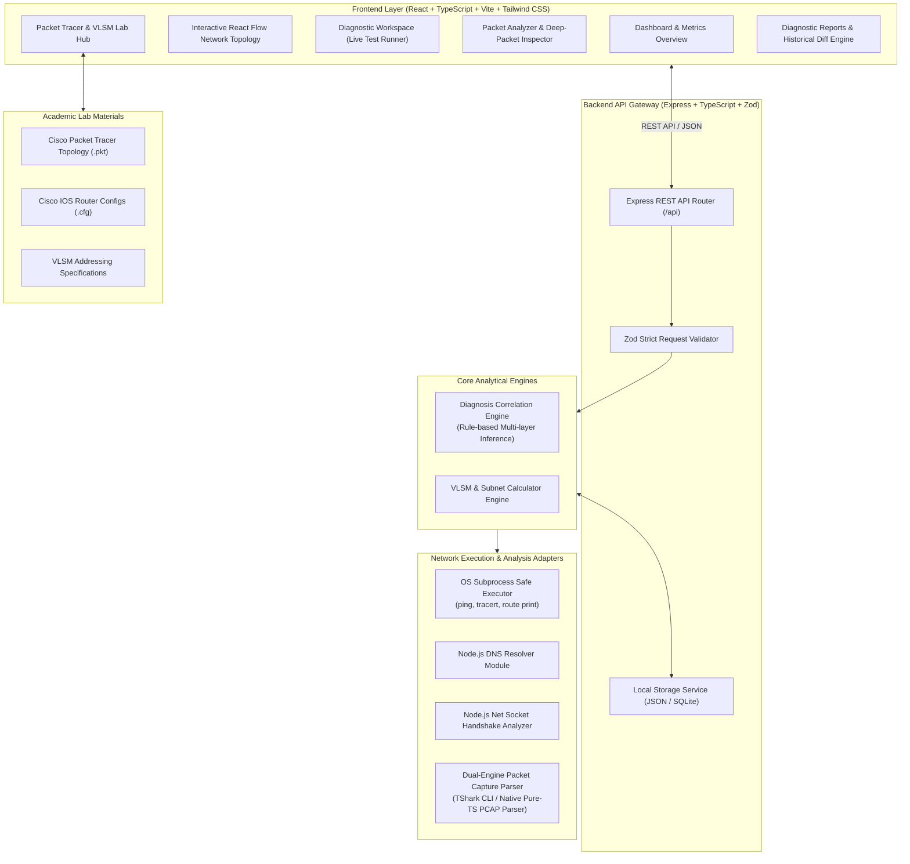
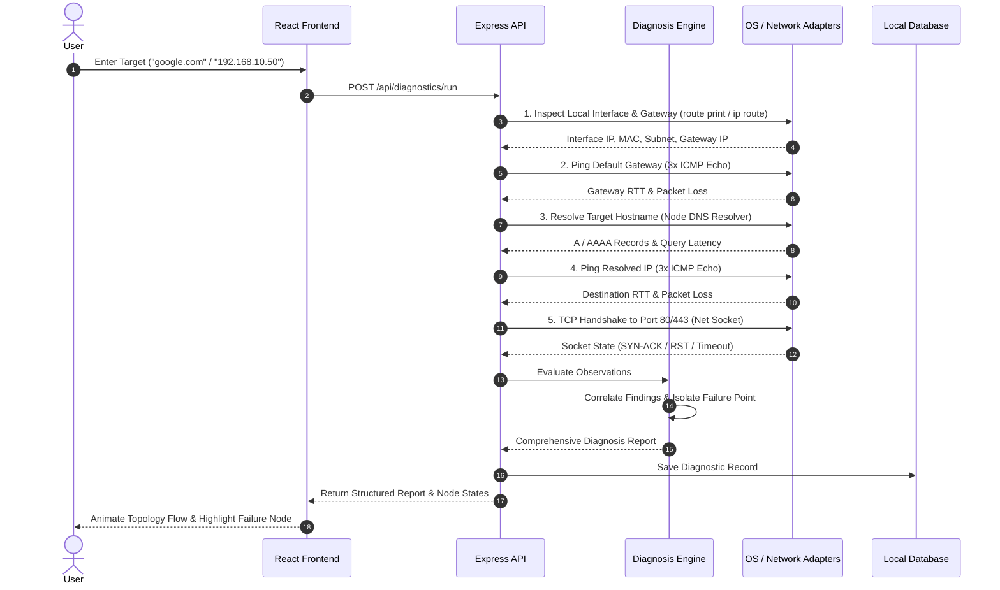

# System Architecture & Technical Specification

## 1. High-Level Architecture Overview

**CONNECTED DOESN'T MEAN CONNECTED** is an evidence-based network diagnosis simulator and packet analysis platform. It links academic network topologies (Cisco Packet Tracer) with actual operating system diagnostics and packet capture analysis (TShark / Native PCAP Parser).

---

## 2. The Evidence-Based Diagnostic Pipeline

Rather than displaying hardcoded mock data, every diagnostic report is generated from concrete observations across five OSI layers:

---

## 3. Strict Evidence Attribution & Academic Honesty

The system strictly tags every single finding with its concrete evidence origin:

| Evidence Tag | Description | Guarantee |
| :--- | :--- | :--- |
| **`LIVE_TEST`** | Real network packets transmitted by host OS network interface | Measured live; includes real latencies, timeouts, and socket responses. |
| **`CAPTURE_ANALYSIS`** | Parsed directly from uploaded PCAP/PCAPNG capture file | Sourced from frame headers parsed by TShark or Native PCAP Parser. |
| **`LAB_EVIDENCE`** | Documented Cisco Packet Tracer virtual topology test results | Derived from simulated Cisco IOS virtual environment. |
| **`SIMULATED`** | Pre-packaged educational failure scenario | Labeled clearly for demonstration and student learning. |

---

## 4. Dual-Engine PCAP/PCAPNG Parser Architecture

To ensure 100% platform portability across any lab machine without requiring administrator privileges or pre-installed tools:

1. **Primary Engine (TShark):**
   - Automatically detected in system `PATH` and standard installation paths (`C:\Program Files\Wireshark\tshark.exe`, `/usr/bin/tshark`, etc.).
   - Executes non-interactively with strict subprocess timeouts (`-T fields`).
2. **Fallback Engine (Native Pure-TS PCAP/PCAPNG Parser):**
   - Built directly into the backend with zero native dependencies.
   - Decodes Ethernet, IPv4, IPv6, TCP, UDP, ICMP, and DNS protocols directly from raw binary buffers.
   - Parses both Classic PCAP (`0xa1b2c3d4`, `0xd4c3b2a1`) and PCAPNG Section Header Blocks (`0x0A0D0D0A`).
